# Pramana

**A single, timestamped, consolidated source of truth for rules, built as a diff-first state engine.**

> **Disclaimer.** Every line of code, every dataset and every run in this repository is **synthetic and for illustrative purposes only**. No real regulation, authority, company or person is represented. The instruments are invented (`SYN-FIL-02`, `SYN-IMP-01`, `SYN-STA-03`), the dates are invented, and the numbers produced by the simulations describe the generators in this repository, not any real legal system. This is a research prototype from [Agravaani Research](https://t.me/agravaani), not legal software and not a government system.

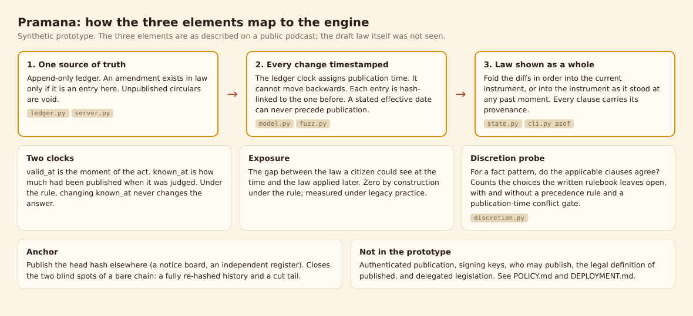

---

## Contents

1. [Why this exists](#why-this-exists)
2. [Where the idea comes from, and what this repository is not](#where-the-idea-comes-from-and-what-this-repository-is-not)
3. [Quick start](#quick-start)
4. [The synthetic example run, step by step](#the-synthetic-example-run-step-by-step)
5. [How it works](#how-it-works)
6. [The schema](#the-schema)
7. [Command reference](#command-reference)
8. [Test bed and failure rates](#test-bed-and-failure-rates)
9. [The discretion probe](#the-discretion-probe)
10. [Policy angle in brief](#policy-angle-in-brief)
11. [Known limits](#known-limits)
12. [Repository layout](#repository-layout)
13. [Deployment](#deployment)
14. [Reproducing every number and image](#reproducing-every-number-and-image)
15. [Explainer video](#explainer-video)
16. [Roadmap](#roadmap)
17. [Credits and licence](#credits-and-licence)

---

## Why this exists

Legal systems rest on the rule that ignorance of the law is no defence. That rule only makes sense if a citizen has a fighting chance of finding out what the law is. In practice a rule is often a stack of circulars, each amending the last, some stated to apply from a date before they were published, some applied by officials without ever having been published anywhere a citizen could look.

Three small requirements would close most of that gap:

1. **One source of truth.** If a rule is not published at the single authoritative place, it does not apply.
2. **Every change timestamped.** Nothing can be changed retrospectively, so it is always possible to say which version of a rule governed a given moment.
3. **The rule shown as a whole.** The current text, and the text as it stood at any past moment, is shown consolidated, not as a pile of amendments the citizen must reconcile by hand.

These are the same three properties a diff-first state engine has by construction: an **append-only ledger of diffs**, a **clock the writer cannot set**, and a **state that is folded from the diffs on demand**. Pramana (Sanskrit *pramāṇa*, an accepted means of valid knowledge, the thing that settles what counts as established) is a small, runnable demonstration of that correspondence.

A second idea sits next to it. Rulebooks get longer because each exception is written in to settle some rare dispute, and the resulting detail can leave an official with *more* choice, not less, because several clauses now apply to the same facts. Pramana includes a **discretion probe** that measures how often the written rulebook leaves a choice open, so the argument can be examined on data instead of by assertion.

## Where the idea comes from, and what this repository is not

The three-part proposal above (a "Transparency of Rules Act") was described by **Sanjeev Sanyal** in a public podcast conversation, from which this prototype works. The framing of the rulebook-complexity problem is also his. This repository is an independent engineering reading of that description and was written without sight of any draft law or of any technical design prepared for it.

- It is **not** an implementation of any draft statute and it is **not** affiliated with, reviewed by, or endorsed by Mr Sanyal, the iSPIRT Foundation, or any government body.
- Where the spoken description is silent, this repository makes a design choice and says so. See [POLICY.md](POLICY.md) for each such choice and the question it should be put to.
- The engine lineage is Agravaani Research's diff-first state engine (the Sutradhar family of tools), applied here to rules instead of clinical records.

## Quick start

Requires Python 3.10 or later. The engine itself has no runtime dependencies.

```bash
git clone https://github.com/agravaaniresearch/pramana.git
cd pramana
pip install -e ".[dev,plots]"

pramana build-synthetic        # writes data/synthetic_ledger.jsonl and data/synthetic_corpus.json
pramana demo                   # the whole walkthrough in one command
pytest -q                      # 51 tests
pramana fuzz --trials 1000     # the adversarial test bed with failure rates
```

The committed files in `data/` are exactly what `pramana build-synthetic` writes, so you can also skip the build step.

## The synthetic example run, step by step

The synthetic world has three invented instruments, fifteen published amendments between April 2023 and March 2025, and two **shadow circulars**: amendments that officials applied to people but that were never published to the source of truth. The corpus deliberately includes the situation that motivates the whole idea.

> A circular is **published at 5:00 pm on 12 December 2024**. It shortens the annual return deadline from 60 days to 45 and states that it applies **from 1 December**. A company filed its return at 4:00 pm that same day.

### 1. The law at 4:00 pm and at 5:01 pm

`pramana asof` consolidates an instrument as it stood at a chosen moment. The clause that governs the deadline is different on either side of 5:00 pm, and the second view carries a flag showing that the circular's backdating was clipped to its publication time.

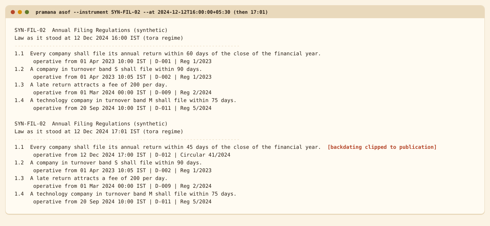

### 2. The whole demonstration

`pramana demo` runs the same story end to end: the two as-of views, what the filing would face under legacy practice, the consolidated instrument, an integrity check, and the discretion probe.

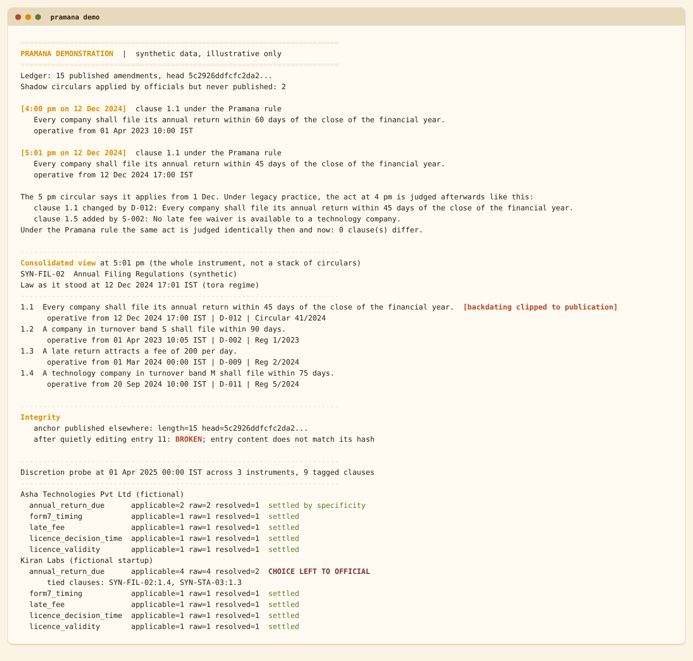

### 3. Exposure: what the citizen could see versus what was applied later

Exposure compares two answers for the same act. The first is the law a citizen could have read at the time of the act. The second is the law applied to that act once everything has surfaced. Under legacy practice the two can differ, and the report names the cause: a backdated amendment or an unpublished circular. Under the Pramana rule the same act judged then and judged later never differs.

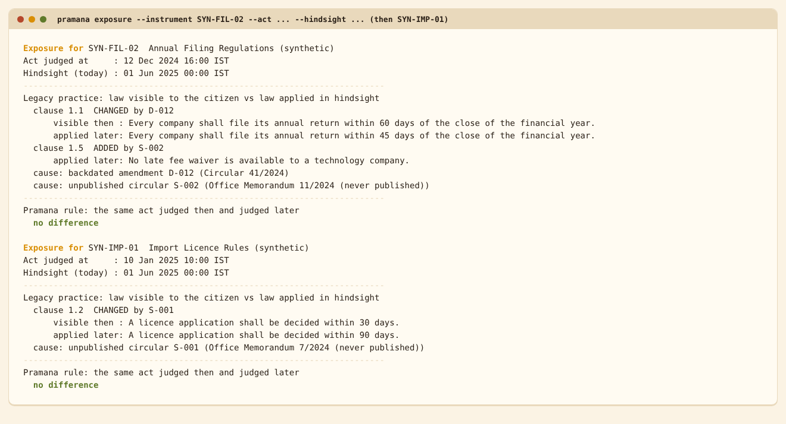

### 4. Tampering is visible

Each entry is hash-linked to the one before it, and the publication time is part of the hash. A quiet edit to one amendment breaks the chain at exactly that entry. The `anchor` command prints a short commitment that can be published elsewhere; later sections explain why that matters.

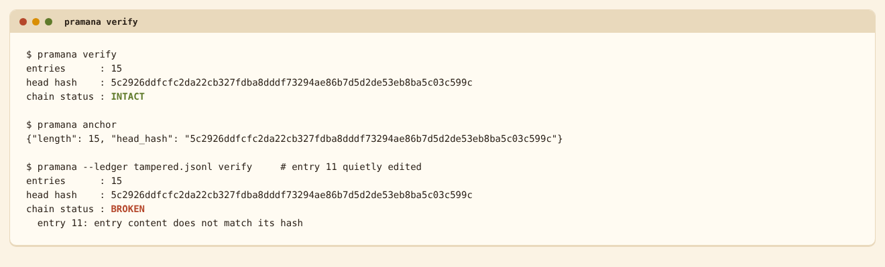

### 5. Where the written rules leave a choice

The probe takes a fact pattern (a fictional company or startup) and asks, for each subject, whether the clauses that apply to it agree. In the synthetic corpus a technology startup in the middle turnover band is covered by two equally specific clauses that disagree (75 days and 60 days), so the rulebook as written leaves the answer to the official.

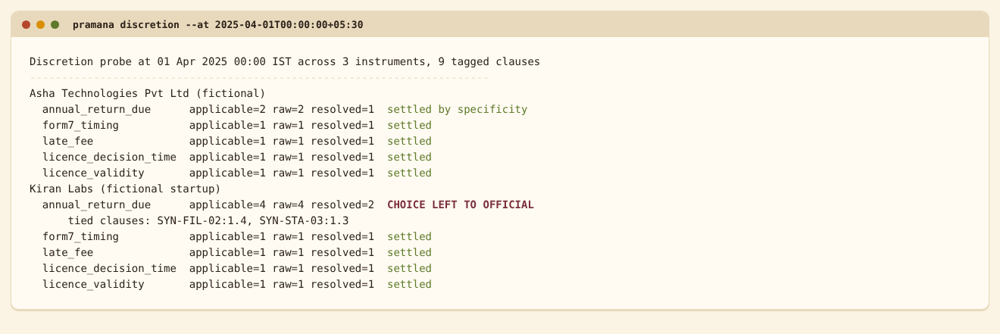

## How it works

### Two clocks

Every judgement involves two moments, and the engine keeps them apart.

| Clock | Meaning | Parameter |
|---|---|---|
| **valid time** | The moment of the act being judged. | `valid_at` |
| **knowledge time** | How much of the ledger had been published when the judgement is made. | `known_at` |

The central property of the proposal is a statement about these clocks: **for a fixed `valid_at`, advancing `known_at` must never change the answer.** The law that governed an act does not change after the act. The test bed checks this directly.

### Two regimes, side by side

| | `legacy` | `tora` (the Pramana rule) |
|---|---|---|
| An amendment applies from | its stated effective date, even if earlier than publication | the **later** of its publication time and its stated effective date |
| Unpublished circulars | can be applied by officials ("shadow" items) | do not exist |
| Law at a fixed past moment as publication proceeds | can change | cannot change |
| Prospective notice (effective date in the future) | honoured | honoured |

Running both regimes on the same ledger is what makes the difference measurable.

### The ledger

The ledger is a list of entries. Each entry holds a sequence number, the hash of the previous entry, a publication time, one amendment and its own hash. The hash is SHA-256 over canonical JSON (sorted keys, no insignificant whitespace) of the first four fields.

- The **publication time is assigned by the ledger clock at the moment of appending**. A caller cannot choose it, and it can never be earlier than the previous entry (`ClockRegression`).
- An amendment may not replace or repeal a clause that does not exist, and may not insert one that already exists.
- A correction is a new amendment. There is no edit operation.

### Consolidation

`consolidate()` selects the amendments that are published by `known_at` and operative by `valid_at`, sorts them by operative time and ledger order, and folds them into a clause table. Every clause in the result carries its provenance: the amendment that last set it, the issuing authority, the source reference, its publication time and its operative time. This is the equivalent of the edit history that collaborative encyclopaedias keep for a page, applied to a rulebook.

## The schema

The schema is the part of this project that matters most. The code could have been written by anyone; the schema is the commitment about what a rule, an amendment and a publication are. Three JSON Schema files (draft 2020-12) in [`schemas/`](schemas/) are normative:

| File | What it fixes |
|---|---|
| [`diff.schema.json`](schemas/diff.schema.json) | One amendment: operation, target clause, authority, source reference, optional claimed effective date. It has **no field for publication time**, on purpose: a caller cannot assert when something was published. A repeal cannot carry a body; an insert or replace must. |
| [`ledger_entry.schema.json`](schemas/ledger_entry.schema.json) | The entry around a diff, with the hash rule stated in its description. Publication time is UTC with second precision. |
| [`corpus.schema.json`](schemas/corpus.schema.json) | The sidecar that is **not law**: instrument titles, shadow circulars and fact patterns. Keeping shadows in a separate file, outside the hash chain, is what stops them being mistaken for published rules. |

The test suite validates every committed entry against these schemas and checks that malformed amendments are rejected. Field-by-field notes are in [docs/SCHEMA.md](docs/SCHEMA.md).

## Command reference

| Command | Purpose |
|---|---|
| `pramana build-synthetic [--out DIR]` | Write the synthetic ledger and corpus. |
| `pramana asof --instrument ID --at TIME [--regime tora\|legacy] [--known-at TIME]` | Consolidated instrument at a moment. |
| `pramana exposure --instrument ID --act TIME --hindsight TIME` | Citizen-visible law versus law applied later. |
| `pramana publish --diff FILE` | Append one amendment to the ledger using the system clock, under a file lock. Refuses to append to a ledger that fails verification. |
| `pramana verify [--anchor JSON]` | Check the hash chain; non-zero exit status if broken. |
| `pramana anchor` | Print the head commitment `{length, head_hash}`. |
| `pramana discretion --at TIME` | Where the rulebook leaves a choice for the corpus fact patterns. |
| `pramana sweep [--max N --step N --seeds N --facts N --json PATH]` | Discretion versus rule density on generated corpora. |
| `pramana fuzz [--trials N --json PATH]` | The adversarial test bed with failure rates. |
| `pramana demo` | Everything above in one walkthrough. |

Timestamps must carry an explicit offset (`2024-12-12T16:00:00+05:30` or `...Z`); a timestamp without one is refused rather than guessed. Stored times are UTC; displays are in IST.

## Test bed and failure rates

There are 51 automated tests in [`tests/`](tests/) covering the ledger, consolidation, the discretion probe, the schemas, the HTTP service and the command line. A mutation check was run on the headline behaviour: removing the rule that clips backdating to publication makes seven tests fail.

The adversarial part is `pramana fuzz`. Every trial is seeded, so each rate below can be reproduced exactly. Full machine-readable results are in [`docs/results/fuzz.json`](docs/results/fuzz.json).

### Tamper detection (1000 trials per attack, random ledgers of 10 to 40 entries)

| Attack | Chain alone | Chain plus published anchor |
|---|---:|---:|
| Edit an amendment's text | 100% | 100% |
| Edit a publication time | 100% | 100% |
| Delete an entry from the middle | 100% | 100% |
| Swap two adjacent entries | 100% | 100% |
| Insert a forged entry in the middle | 100% | 100% |
| Append an entry with an earlier time, correctly hashed | 100% | 100% |
| **Rewrite history and re-hash every later entry** | **0%** | 100% |
| **Cut entries off the end** | **0%** | 100% |

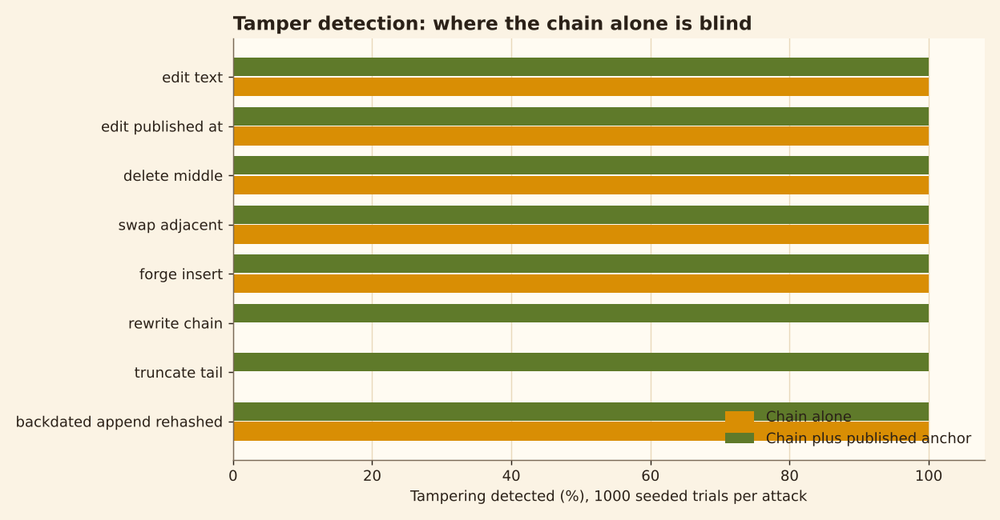

**Read the two zero rows carefully.** A hash chain on its own cannot see a fully re-hashed history or a truncated tail, because both leave a chain that is internally consistent. This is a known property of hash chains, and the test bed confirms it rather than hiding it. The remedy is to **publish the head hash somewhere the ledger's operator does not control** (an independent register, a notice board, the Gazette). With that anchor, all eight attacks are detected in every trial. The prototype implements the verification; running the anchoring process is a deployment decision ([DEPLOYMENT.md](DEPLOYMENT.md)).

### Clock regression

A publication attempt carrying a time earlier than the current head was refused in **1000 of 1000** trials (95% Wilson interval 99.6% to 100%).

### Does the law judged at a fixed moment stay put?

For random ledgers, the engine judges an act at a fixed time, once using only what was published by then and once using everything published later, and counts the probes where the answer differs.

| Amendments stated to apply from before publication | Probes | Changed under Pramana rule | Changed under legacy practice |
|---:|---:|---:|---:|
| 0% | 10,764 | 0 | 0.0% |
| 5% | 10,788 | 0 | 1.5% |
| 10% | 10,788 | 0 | 3.4% |
| 25% | 10,800 | 0 | 9.0% |

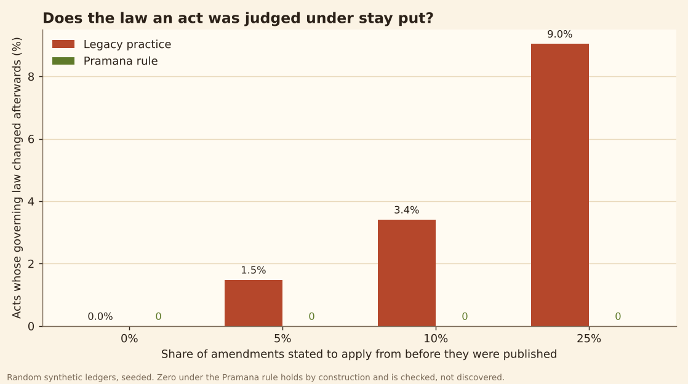

The zero in the Pramana column holds **by construction**: an amendment cannot become operative before it was published, so later publications cannot reach back. It is verified here as a regression guard on the implementation, not discovered as an empirical result. The legacy column is simply the share of probes touched by a backdated amendment in the generator, so it scales with the backdating share the generator is told to use. It shows that the measurement works; it does not estimate how often this happens in any real system.

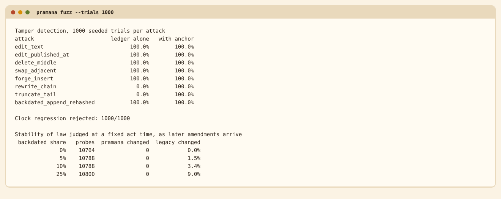

## The discretion probe

For a fact pattern and a subject, the probe lists the clauses that apply and asks whether they agree. It reports two readings: **raw** (any applicable clause may be chosen) and **resolved** (the most specific applicable clauses win, and a choice remains only where equally specific clauses disagree).

The sweep builds one universal rule, adds *n* narrower exception clauses with random scopes and random values, samples 400 random fact patterns per corpus, and averages over 20 seeds.

| Exception clauses | No precedence rule | Most specific wins | With a conflict gate at publication | Share of proposals the gate refuses |
|---:|---:|---:|---:|---:|
| 0 | 0.0% | 0.0% | 0.0% | 0.0% |
| 8 | 74.3% | 15.2% | 0.0% | 34.4% |
| 16 | 93.6% | 30.4% | 0.0% | 54.1% |
| 24 | 99.7% | 40.6% | 0.0% | 59.6% |
| 40 | 100.0% | 50.8% | 0.0% | 66.6% |

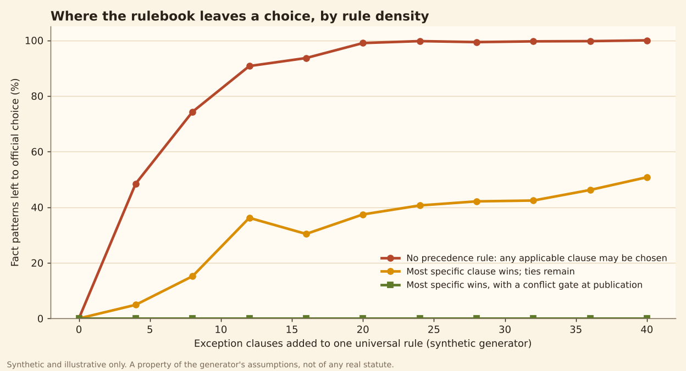

What this supports, and what it does not:

- It shows that **the probe works** and that, *in a generator where exceptions are authored independently*, choice left to the official rises with the number of exceptions, whether or not a precedence rule exists. That is the mechanism behind the claim that detailed rulebooks can increase discretion. Whether real rulebooks behave this way is an empirical question this repository does not answer, and the published studies the argument leans on have not been reviewed here.
- The levels depend entirely on generator assumptions (five possible values, random scopes, independent authorship). Different assumptions give different curves.
- "Most specific wins" is one interpretive rule among several. The probe reports where a precedence rule is *needed*; it does not say which resolution is correct.
- The conflict gate (refuse any new clause that would create an equally specific, overlapping, contradictory clause) removes unresolved ties by construction. The cost is visible in the last column: in this generator, most independently written exceptions would have been refused. That is a statement about the generator, and a prompt to ask what a real publication-time check would reject.
- This is only half of the argument. The other half, a working grievance and adjudication path for the rare case, is not modelled here.

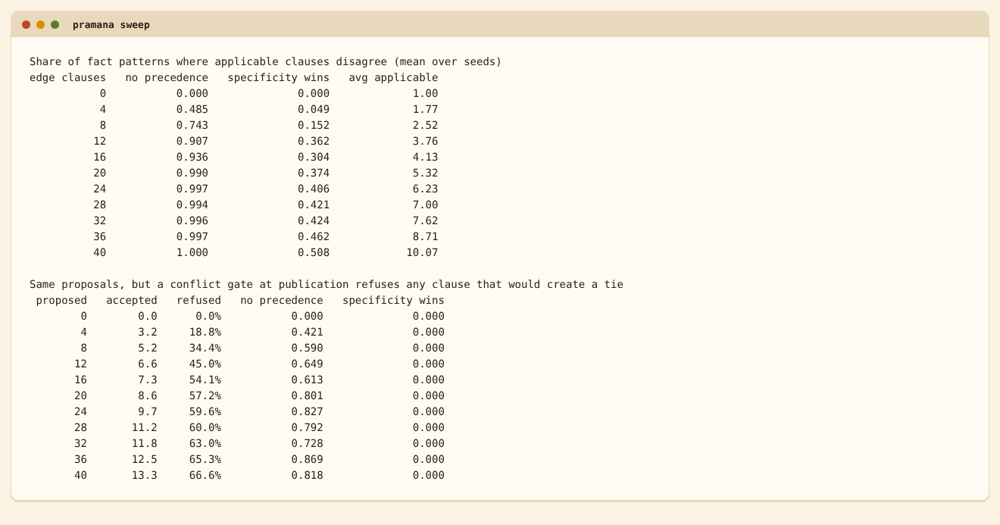

## Policy angle in brief

[POLICY.md](POLICY.md) is the full review. The headline points:

- **What the engine settles** is narrow and mechanical: which published text governed which moment, and whether the record has been altered.
- **What it does not settle** is most of the law: what counts as "published" and by whom, the hierarchy between statute, delegated rules and circulars, validating Acts that Parliament may pass with retrospective effect, emergency or security orders that cannot be published immediately, court decisions that change the meaning of a rule, and the grievance path for the cases no rulebook foresees.
- **A design option worth examining**: refusing only *burdensome* retrospectivity while still allowing *beneficial* retrospectivity (for example, a correction that relieves a citizen). The prototype clips all backdating; it does not implement the asymmetric option.
- **Questions for the people drafting the law** are collected at the end of POLICY.md.

## Known limits

- The ledger clock is a trust assumption. If the operator controls the clock, they control publication time. Independent trusted timestamping or an external witness is the mitigation and is outside the prototype.
- Hash chain, not Merkle tree. Verification is linear in ledger length and there are no compact inclusion proofs.
- Publication is a bare command (`pramana publish`) with a file lock and the system clock. There is no authentication, no signing and no approval workflow; the HTTP service is read-only by design.
- No legal hierarchy, no delegated-legislation model, no validating Acts, no court-order events.
- Clause scope is a simple attribute-and-value match. Real rules turn on definitions, thresholds and cross-references that this model does not capture.
- The synthetic corpus is small by design: three instruments, fifteen amendments, two shadow circulars. It illustrates mechanisms; it does not stress scale.
- Only the Python standard library path is tested for the service. The Dockerfile was written but **not built in the authoring environment** (no container daemon was available); the same steps were run and smoke-tested in a clean virtual environment. See DEPLOYMENT.md.

## Repository layout

```
pramana/
├── README.md              this file
├── POLICY.md              policy-angle review and questions for drafters
├── DEPLOYMENT.md          standalone guide so any engineer can deploy without reading the rest
├── Dockerfile             container image (read-only service)
├── deploy/                systemd unit and reverse-proxy snippet
├── schemas/               normative JSON Schemas (diff, ledger entry, corpus)
├── data/                  synthetic ledger and corpus (committed, regenerable)
├── src/pramana/
│   ├── model.py           timestamps, canonical hashing, validation, error types
│   ├── ledger.py          append-only hash-chained ledger, verify, anchor
│   ├── state.py           consolidation, as-of, exposure, rendering
│   ├── discretion.py      discretion probe, sweep, conflict gate
│   ├── synth.py           synthetic corpus and random ledgers for fuzzing
│   ├── fuzz.py            adversarial test bed and failure-rate measurement
│   ├── cli.py             command line
│   └── server.py          read-only HTTP API (standard library only)
├── tests/                 51 tests
├── scripts/
│   ├── make_screenshots.py  regenerates every image from real runs
│   └── smoke_test.py        post-deployment check
├── video/                 Remotion source of the explainer video
└── docs/
    ├── video/             pramana_explainer.mp4
    ├── SCHEMA.md
    ├── results/           fuzz.json, discretion_sweep.json and text output
    └── screenshots/       images used in this README
```

## Deployment

[DEPLOYMENT.md](DEPLOYMENT.md) is a self-contained guide: container and non-container paths, configuration, endpoints, a smoke test, security notes and what a production deployment must add. It is written so that an engineer can deploy the service without reading anything else in this repository.

## Reproducing every number and image

```bash
pip install -e ".[dev,plots]"
pytest -q                                   # 51 passed
pramana fuzz --trials 1000 --json docs/results/fuzz.json
pramana sweep --json docs/results/discretion_sweep.json
python scripts/make_screenshots.py          # needs google-chrome or chromium on PATH
```

Screenshots are photographs of the real captured output of the real commands (terminal views) or charts drawn from the JSON files above. Nothing is mocked. Seeds are fixed, so figures are identical on every run.

## Explainer video

A 56 second self-explanatory walkthrough (the 4:00 pm and 5:00 pm problem, the two regimes, the three requirements, tamper evidence, the failure rates and the discretion curves) is at [`docs/video/pramana_explainer.mp4`](docs/video/pramana_explainer.mp4). It is built with Remotion from the same JSON results as the charts; the source is in [`video/`](video/) (`cd video && npm install && npm run render`, which needs Chrome and writes to `docs/video/`).

## Roadmap

- Merkle-tree ledger with compact inclusion proofs and signed tree heads.
- Signed publication with authority keys, and an independent anchor service.
- A hierarchy model (Act, rules, notifications, circulars) with precedence.
- Beneficial-retrospectivity option and a validating-Act operation, once the policy questions are answered.
- A citizen-facing reader: pick a date, see the whole instrument, with its edit history.
- Adjudication events as first-class entries, to model the redress path that the discretion argument depends on.

## Credits and licence

- The three-part proposal, and the framing of the rulebook-complexity problem it answers, are Sanjeev Sanyal's, as described in a public podcast conversation. Any misreading in this prototype is this repository's.
- Engine design, schemas, synthetic data, test bed and write-up: Agravaani Research (Dr Abhishek Puri).
- Built with the assistance of Claude (Anthropic).
- Licensed under the Apache License 2.0; see [LICENSE](LICENSE).

*Code and runs are synthetic and for illustrative purposes only.*
